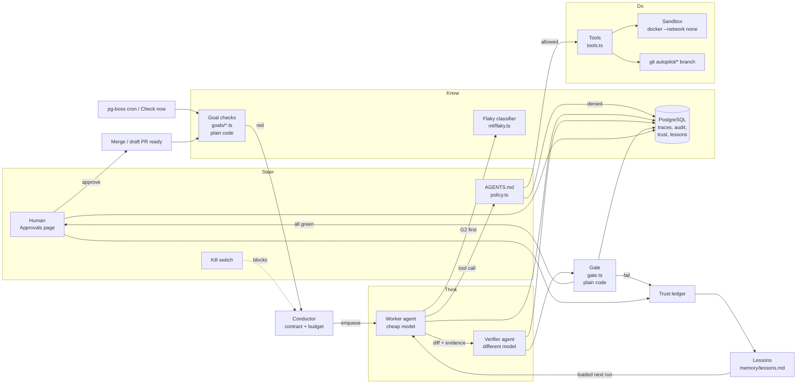

# Project Autopilot: Architecture

## 1. Components

| Component | Module | Responsibility |
|---|---|---|
| Dashboard + API | `apps/web` | Next.js App Router UI and route handlers. Reads state through `packages/core`, enqueues jobs. |
| Worker process | `apps/worker/src/index.ts` | pg-boss consumer: daily goal-check cron, `check-goals` and `run-job` queues. |
| CLI | `packages/cli/src/index.ts` | `seed`, `check`, `run`, `train`, `kill`, `resume`, `demo-bad-worker`, `eval`, `approve`. |
| Database | `packages/db/prisma/schema.prisma` | PostgreSQL 16 via Prisma. All state, traces and audit. |
| Config | `packages/core/src/config.ts` | Env loading, pinned model IDs, budgets, trust config. |
| Constitution | `AGENTS.md` + `packages/core/src/policy.ts` | Rules enforced in code before every tool call and git operation. |
| Contracts | `packages/core/src/contract.ts` | Zod schema for a job: allowed/forbidden paths, budgets, done criteria, risk. |
| Standing goals | `packages/core/src/goals/*.ts` | G1–G3 `check()` functions. Plain code, no LLM. |
| Conductor | `packages/core/src/conductor.ts` | Turns red goals into contracts and jobs. Dedupe, cap of 3, kill switch, enqueue. |
| Model gateway | `packages/core/src/llm/gateway.ts` | `complete()`, retries/backoff, mock fallback, cost and latency logging. |
| Budget router | `packages/core/src/llm/router.ts` | Easy → `WORKER_MODEL`, hard → `HARD_WORKER_MODEL`. Throws if the verifier model equals the worker model. |
| Providers | `packages/core/src/llm/{anthropic,openai,mock}.ts` | Anthropic SDK, OpenAI SDK and a deterministic offline mock. |
| Worker agent | `packages/core/src/agents/worker.ts` | Bounded plan → act → observe → reflect loop with a checkpoint per step. |
| Tools | `packages/core/src/agents/tools.ts` | `read_file`, `list_files`, `write_file`, `run_tests`, `run_command`, `search_lessons`. All policy-checked. |
| Untrusted-data wrapper | `packages/core/src/untrusted.ts` | Wraps all file/tool content in `<untrusted_data>` and flags injection patterns. |
| Verifier agent | `packages/core/src/agents/verifier.ts` | A different model checks the diff and evidence against the contract. Strict zod JSON. |
| Gate | `packages/core/src/gate.ts` | Plain-code final pass/fail: fresh-sandbox tests, lint, paths, secrets, package existence, goal green, verdict, budget. |
| Sandbox | `packages/core/src/sandbox.ts` | `docker run node:22-slim --network none` with CPU/memory/time limits. Unsafe local fallback. |
| Git helpers | `packages/core/src/git.ts` | Workspace clones, `autopilot/*` branches, diffs and merges. Refuses AI writes to `main`. |
| Pipeline | `packages/core/src/pipeline.ts` | Runs one job end to end: worker → verifier → gate → approval queue. |
| Approvals | `packages/core/src/approvals.ts` | Approve / reject / request changes. Local merge or GitHub draft-PR ready. |
| Trust ledger | `packages/core/src/trust.ts` | Per-job-type levels L0–L2, promotion and demotion, full history. |
| Lessons | `packages/core/src/lessons.ts` | Writes the `Lesson` row and `memory/lessons.md`. Keyword retrieval. |
| Flaky classifier | `packages/core/src/ml/{logreg,flaky}.ts` | Logistic regression trained on `ci_history.csv`. |
| GitHub mode | `packages/core/src/github.ts` | Octokit: push branch, open a draft PR, mark ready. Never merges. |
| Real-mode sources | `packages/core/src/sources.ts` | OSV advisories and npm registry existence checks. |
| Audit log | `packages/core/src/audit.ts` | Writes `AuditEvent` for every action and every policy denial. |
| Settings / kill switch | `packages/core/src/settings.ts` | `Setting` rows: kill switch, trust config. |
| Queue | `packages/core/src/queue.ts` | pg-boss wrapper (`autopilot-check-goals`, `autopilot-run-job`, daily cron). |
| Goal loop | `packages/core/src/checks.ts` | Check all goals, then let the conductor open jobs for red ones (daily cron). |
| Task brief | `packages/core/src/agents/task.ts` | The worker's `<task>` (trusted, harness-computed) plus untrusted attachments. |
| Dashboard read models | `packages/core/src/queries.ts` | Queries behind the API route handlers. |
| Eval runner | `packages/cli/src/eval.ts`, `packages/cli/src/eval-cases.ts` | 10 verifier cases. Mock runner for CI; generates promptfoo files. |
| Seeder | `packages/core/src/seed/*` | Generates the deterministic `demo_target` repo with the three planted problems. |
| Evals | `evals/promptfoo.yaml`, `packages/cli/src/eval.ts` | Verifier prompt evals (promptfoo for real providers, mock runner for CI). |

## 2. Data flow

**Sequence for one job:**

1. A goal check turns red. The result is stored in `GoalCheck`.
2. The conductor creates a `Contract` and a `Job`, then enqueues `autopilot-run-job`. It skips if the kill switch is on, a job for that goal is already open, or 3 jobs are open.
3. `apps/worker` picks the job up. The workspace is a fresh clone at `.autopilot/workspaces/<jobId>` on branch `autopilot/<jobId>`.
4. The worker loop runs. Every tool call goes through `policy.ts` first. Every step is checkpointed in `JobStep`.
5. The worker returns a `WorkerResult` (diff, evidence, explanation). The branch is committed and pushed to the target repo (only `autopilot/*`).
6. The verifier, on a different model, reviews the contract, diff, evidence and explanation. It returns strict JSON.
7. The gate runs plain-code checks in a **fresh** sandbox. Each result is stored in `GateResult`.
8. If everything passes, the job waits for a human (`awaiting_approval`). Otherwise it ends as `gate_failed` and trust is demoted.
9. If a human approves, the branch is merged (local) or the PR is marked ready (GitHub). Goals are re-checked, trust is updated and a lesson is written.

## 3. Concept map

| Concept | Where it lives |
|---|---|
| **Think** (reasoning) | `agents/worker.ts` (worker LLM), `agents/verifier.ts` (verifier LLM), `llm/*` |
| **Know** (state and memory) | `goals/*.ts`, `packages/db` (Postgres), `lessons.ts` + `memory/lessons.md`, `ml/flaky.ts` |
| **Do** (act on the world) | `agents/tools.ts`, `sandbox.ts`, `git.ts`, `github.ts` |
| **Steer** (humans and rules) | `AGENTS.md` + `policy.ts`, `approvals.ts`, `settings.ts` (kill switch), `trust.ts`, contracts |
| **Agent = Model + Harness** | Model: `llm/gateway.ts` + `llm/router.ts`. Harness: `agents/worker.ts` loop + `tools.ts` + `policy.ts` + `sandbox.ts` + budgets in `contract.ts` |
| **Agent loop** (plan → act → observe → reflect) | `agents/worker.ts` `runAgentLoop()`. *Plan:* model call. *Act:* a policy-checked tool. *Observe:* the tool result wrapped as untrusted data. *Reflect:* done-check + budget/kill-switch check + `JobStep` checkpoint. |
| **1. Constitution** | `AGENTS.md`, enforced in `packages/core/src/policy.ts` |
| **2. Contracts** | `packages/core/src/contract.ts`, `Contract` table, `conductor.ts` |
| **3. Workers** | `packages/core/src/agents/worker.ts`, `agents/tools.ts` |
| **4. Verifiers** | `packages/core/src/agents/verifier.ts` (AI) + `packages/core/src/gate.ts` (code) |
| **5. Trust ledger** | `packages/core/src/trust.ts`, `TrustRecord` / `TrustEvent` |
| **6. Standing goals** | `packages/core/src/goals/*.ts`, `GoalCheck`, pg-boss cron in `apps/worker` |
| **7. Budget router** | `packages/core/src/llm/router.ts`, `llm/pricing.ts`, budgets enforced in `agents/worker.ts` |
| **8. Improvement loops** | `packages/core/src/lessons.ts` (lessons fed into the next run), `trust.ts` (autonomy follows the track record), `ml/flaky.ts` (`pnpm cli train` retrains) |
| **"Never let AI grade its own homework"** | `router.ts` throws if verifier model == worker model. The verifier sees no worker reasoning. `gate.ts` is plain code and has the final say. A human approves the merge. |

## 4. Trust model

| Level | Name | What Autopilot may do |
|---|---|---|
| L0 | Propose only (default) | Work on a branch in an isolated workspace. In GitHub mode it does **not** push until a human approves. A human approves every merge. |
| L1 | Branch + PR | May push `autopilot/*` branches and open **draft** PRs without asking first. Merges still need a human. |
| L2 | Auto-merge | Only if the job type has `autoMergeAllowed: true` (default `false` for all types) **and** no changed path is high-risk. |

- **Promotion:** after `promoteAfter` consecutive approved passes (default 3), the level goes up by one (max 2).
- **Demotion:** any gate failure or human rejection drops the level by one (min 0) and resets the streak.
- Every change is a `TrustEvent` row. Nothing is overwritten.

Independent of trust, these always apply: never write to `main`, high-risk paths always need a human, and the gate always runs.

## 5. Safety layers (defence in depth)

1. **Policy (`policy.ts`)** runs before every tool call and blocks:
   - paths outside the contract;
   - high-risk paths;
   - commands not on the allow-list;
   - any git ref that is not `autopilot/*`;
   - unknown dependencies.
2. **Untrusted data (`untrusted.ts`):** all file contents and tool outputs go to the model inside `<untrusted_data>` with a system-prompt rule. Injection-like lines are flagged in the audit log.
3. **Sandbox (`sandbox.ts`):** Docker, `--network none`, `--cpus 1`, `--memory 512m`, timeout, read-only copy of the workspace. The local fallback shows an "Unsafe: no container" warning.
4. **Verifier:** a different model checks scope, evidence and signs of injection.
5. **Gate:** plain code, fresh sandbox, final say.
6. **Human:** approval for every merge at L0–L1.
7. **Budgets + kill switch:** hard stops.

## 6. Why the flaky classifier is ML, not an LLM

Deciding "flaky or real?" happens on **every** red CI run. That makes it:

- **High volume:** hundreds of runs per week in a real project. An LLM call per run adds up. Logistic regression costs microseconds and $0.
- **Consistency-sensitive:** the same evidence must give the same answer, so triage is predictable and auditable. A trained model is deterministic. An LLM isn't guaranteed to be.
- **Structured:** the signal is in a few numeric features (historical failure rate, re-run result, files changed, test file touched, time of day). That's exactly what a linear model is good at, and the weights explain the decision.
- **Measurable:** held-out precision and recall are computed on every `pnpm cli train` and shown on the ML page.

The LLM is only called in the uncertain band (0.3 < p < 0.7), where reading the logs adds value.

## 7. Model and cost tracking

- Every call records provider, pinned model ID, input/output tokens, estimated USD (`llm/pricing.ts`) and latency in `JobStep`.
- Model IDs come from config and are recorded on every trace.
- Mock mode records the configured model IDs with `provider = mock`. Its token counts are estimated as characters ÷ 4, so cost figures in mock mode are **estimates of what the run would have cost**.
